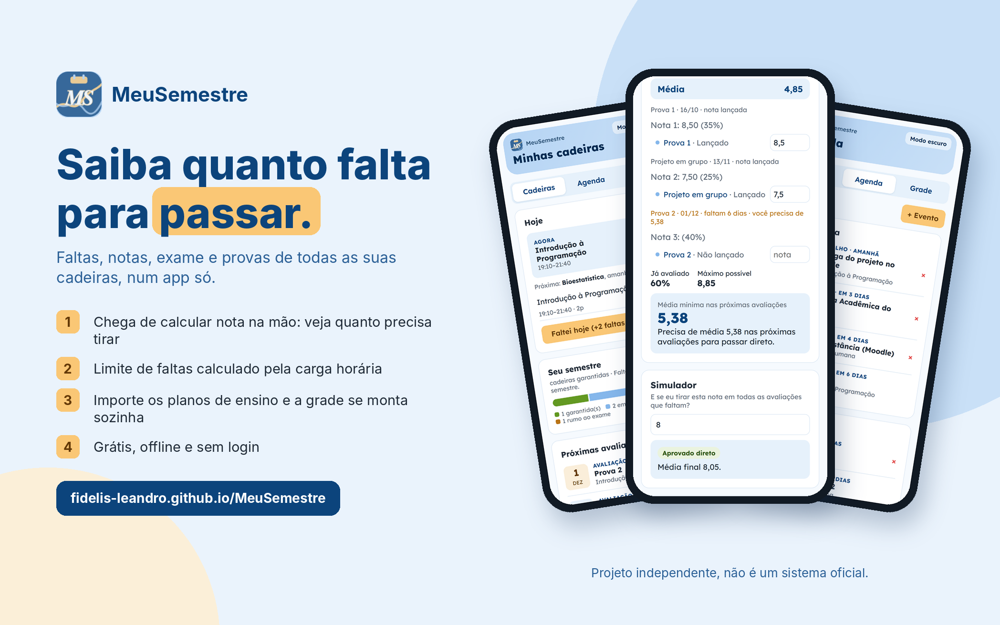

# MeuSemestre

**Saiba quanto falta para passar, sem planilha.**

Faltas, notas, provas e o horário da semana de todas as suas cadeiras, num app que abre no celular.

### [Abrir o MeuSemestre](https://fidelis-leandro.github.io/MeuSemestre/)

> **Projeto independente feito por aluno. Não é um sistema oficial da UFCSPA.**

## Por que usar

- **Nunca mais ser pego de surpresa pelas faltas.** Você vê quantas faltas ainda pode ter em cada cadeira. Um toque em "Faltei hoje" registra todas as aulas do dia.
- **Saber a nota que precisa.** A cada nota lançada, o app recalcula a média que falta nas próximas avaliações, para passar direto ou para ter direito a exame. O simulador mostra o que acontece se você tirar uma nota qualquer.
- **Tudo pronto em segundos com o plano de ensino.** Escolha os PDFs dos planos de ensino de todas as cadeiras de uma vez. O app cadastra carga horária, dias de aula, avaliações, pesos e as datas do cronograma, e você confere tudo antes de salvar.
- **Agenda com o semestre inteiro.** Provas, trabalhos, seminários, exame, aulas EAD e eventos do curso aparecem em "Esta semana" e "Próximas semanas", com a grade semanal ao lado.
- **Funciona sem internet.** Depois da primeira visita, o app abre e lê o plano de ensino mesmo offline.
- **Seus dados ficam só no seu celular.** Sem conta, sem login e sem servidor. Para trocar de aparelho, salve um backup em arquivo.

## Comece em 3 passos

1. **Abra o link** [fidelis-leandro.github.io/MeuSemestre](https://fidelis-leandro.github.io/MeuSemestre/) no celular.
2. **Adicione à tela inicial.** No iPhone (Safari): botão Compartilhar → "Adicionar à Tela de Início". No Android (Chrome): menu ⋮ → "Adicionar à tela inicial" ou "Instalar app". Ele passa a abrir como um app, com ícone próprio.
3. **Importe os planos de ensino.** Baixe o Plano de Ensino de cada cadeira em PDF, toque em "Importar planos de ensino" e escolha todos de uma vez. Confira as datas marcadas para conferir e pronto.

## Perguntas frequentes

**É oficial da UFCSPA?**
Não. É um projeto independente, feito por um aluno. Não tem ligação com a universidade.

**Meus dados vão para algum servidor?**
Não. Cadeiras, faltas e notas ficam salvas só no seu aparelho. O plano de ensino é lido no próprio navegador e não é enviado para lugar nenhum.

**Funciona offline?**
Sim. Depois da primeira visita, tudo funciona sem internet, inclusive a importação do plano de ensino.

**Precisa pagar ou criar conta?**
Não. É gratuito e não pede cadastro.

**Como as regras são calculadas?**

| Situação | Regra |
|---|---|
| Limite de faltas | 25% dos períodos de 50 min (ex.: 60h = 72 períodos = 18 faltas) |
| Aprovação direta | Média ≥ 7 |
| Exame | Média entre 4 e 6,9 e presença ≥ 75% |
| Reprovação | Média < 4 ou faltas acima de 25% |
| Nota final com exame | 0,6 × média + 0,4 × exame ≥ 6 |
| Nota necessária no exame | 15 − 1,5 × média |

## Para desenvolvedores

HTML, CSS e JavaScript puro (módulos ES, sem framework e sem build). PDF.js (Mozilla) para ler os planos de ensino e fonte Lexend (SIL Open Font License 1.1), ambos incluídos no projeto. Service Worker e Web App Manifest para funcionar offline e ser instalável. Dados em `localStorage`; site no GitHub Pages.

Basta o Node 22 ou mais novo, sem dependências:

- **Servidor local:** `node ferramentas/servidor.mjs [porta]` (padrão 8080). Mostra o endereço para o PC e para o celular no mesmo Wi-Fi. Pelo IP da rede o service worker não ativa (exige HTTPS ou localhost).
- **Testes unitários:** `node --test "tests/*.test.js"`.
- **Roteiros no navegador** (Chrome headless; outro executável pela variável `CHROME`), em `tests/navegador/`:
  - `refatoracao.mjs [commit]`: compara ~60 passos de uso com um commit (padrão `HEAD`) e confere service worker, cache e uso offline;
  - `plano-celulas.mjs`: importação de planos com cronograma em células coloridas;
  - `turmas-e-grade.mjs`: planos com várias turmas, grade e telas de iPhone;
  - `animacoes.mjs [reduce]`: animações, com e sem movimento reduzido.
- **PDFs de teste:** sintéticos, sem dados pessoais. São gerados por `node tests/navegador/gerar-plano-teste.mjs <saida.pdf> [variante]`.

Os roteiros saem com código 1 se algo falhar. Arquivos temporários ficam em `tests/navegador/tmp/`, fora do git.

## Autor

**Leandro Fidelis**, estudante de Informática Biomédica na UFCSPA.
