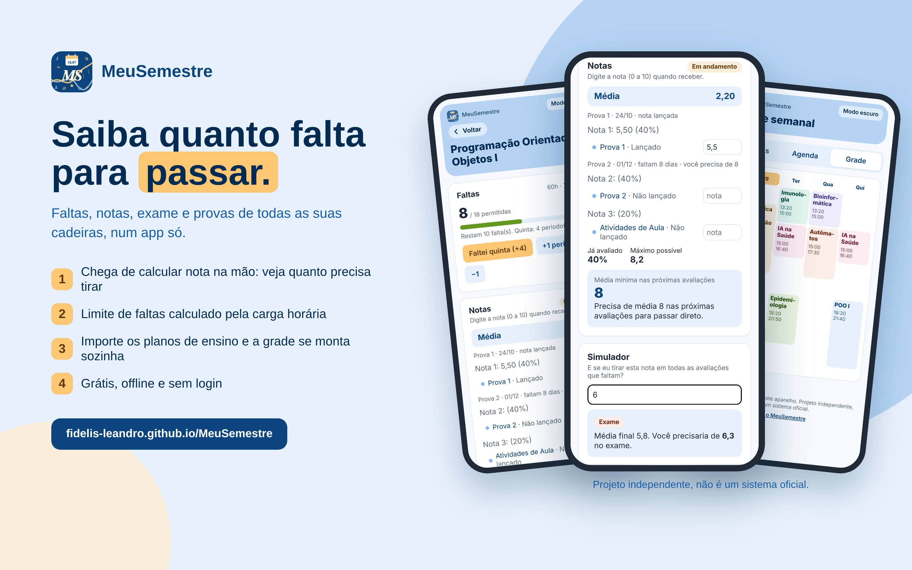

# MeuSemestre

Controle de faltas e notas para alunos da UFCSPA. Cadastre suas cadeiras e o app mostra, em tempo real, quantas faltas você ainda pode ter e quanto precisa tirar para passar, direto ou no exame.

**Acesse:** https://fidelis-leandro.github.io/MeuSemestre/

> Projeto independente feito por aluno. Não é um sistema oficial da UFCSPA.

## Funcionalidades

- **Controle de faltas por período (50 min):** informe a carga horária e o app calcula o limite de 25% (ex.: 60h = 72 períodos = 18 faltas). Um toque registra o dia inteiro de aula.
- **Notas com pesos:** cadastre as avaliações e seus pesos. Cada nota pode ser dividida em partes (ex.: prova + trabalho).
- **Quanto falta para a média 7:** a cada nota lançada, o app recalcula a média mínima necessária nas próximas avaliações.
- **Cálculo do exame:** se a média ficar entre 4 e 6,9, mostra a nota necessária no exame.
- **Hoje e grade semanal:** a tela inicial mostra a aula de agora, a próxima e as aulas do dia, com um botão "Faltei hoje" que registra as faltas de todas as aulas do dia de uma vez. A aba Grade mostra a semana em formato de tabela.
- **Agenda:** adicione a data de cada avaliação e eventos avulsos (trabalhos, seminários, datas limite). A agenda separa em "Esta semana", "Próximas semanas" e "Já passou", e a tela inicial mostra as próximas avaliações.
- **Simulador:** teste uma nota hipotética e veja se você passaria direto, iria para exame ou reprovaria.
- **Importar planos de ensino:** escolha os PDFs dos planos de ensino de todas as cadeiras de uma vez. O app cadastra cada cadeira com carga horária, dias de aula, avaliações e pesos, e liga cada avaliação à sua data no cronograma (provas, trabalhos, seminários e questionários), pelas cores e pelo texto das linhas. Na revisão, cada data mostra de onde veio, e as que precisam ser conferidas ficam marcadas. Exame, aulas EAD, eventos (Semana Acadêmica, Mostra etc.) e atividades substitutivas vão para a agenda. O plano é um documento público da disciplina, sem dados pessoais, e é lido no próprio navegador.
- **Backup:** salve todos os dados num arquivo e restaure em outro aparelho. O app lembra de fazer backup a cada 7 dias.
- **App instalável (PWA):** adicione à tela inicial e ele abre como um app, com ícone próprio. Depois da primeira visita, funciona totalmente offline, inclusive a leitura do PDF.
- **Modo escuro:** segue o tema do celular automaticamente, ou pode ser escolhido manualmente.
- **Sem login e sem servidor:** os dados ficam salvos no próprio aparelho.

## Regras utilizadas

| Situação | Regra |
|---|---|
| Aprovação direta | Média ≥ 7 |
| Exame | Média entre 4 e 6,9 e presença ≥ 75% |
| Reprovação | Média < 4 ou faltas acima de 25% |
| Nota final com exame | 0,6 × média + 0,4 × exame ≥ 6 |
| Nota necessária no exame | 15 − 1,5 × média |

## Tecnologias

HTML, CSS e JavaScript puro (módulos ES, sem framework e sem etapa de build). A leitura do PDF usa a biblioteca PDF.js (Mozilla), incluída no projeto. A fonte é a Lexend (variável, licença SIL Open Font License 1.1, em `fonts/`), hospedada no próprio site: funciona offline e não carrega nada de terceiros. Service Worker e Web App Manifest para funcionar offline e ser instalável. Os dados ficam em `localStorage` e o site é hospedado no GitHub Pages.

## Desenvolvimento

Não há dependências nem etapa de build; basta o Node (22 ou mais novo). O app usa módulos JavaScript, que o navegador não carrega abrindo o arquivo direto (`file://`), então é preciso servir a pasta.

- **Servidor local:** `node ferramentas/servidor.mjs` serve o projeto na porta 8080 e mostra os endereços: `http://localhost:8080/` no PC e `http://<ip-do-pc>:8080/` no celular, no mesmo Wi-Fi. Outra porta: `node ferramentas/servidor.mjs 3000`. Pelo IP da rede o navegador não ativa o service worker (exige HTTPS ou localhost), então instalação e modo offline só funcionam no `localhost` ou no site publicado.
- **Testes unitários** (regras de cálculo, leitura de planos com turmas, cronograma por células, tipos de linha e datas das avaliações, faixas da grade): `node --test "tests/*.test.js"`. O padrão explícito evita que o Node também rode as cópias de commits guardadas em `tests/navegador/tmp/`.
- **Roteiros no navegador** (usam o Chrome instalado, em modo headless; outro executável pela variável `CHROME`):
  - `node tests/navegador/animacoes.mjs` e `node tests/navegador/animacoes.mjs reduce`: conferem as animações com e sem `prefers-reduced-motion`.
  - `node tests/navegador/refatoracao.mjs [commit]`: repete ~60 passos de uso na pasta atual e numa cópia do commit (padrão `HEAD`) e compara tela e dados passo a passo; depois confere service worker, cache e importação de PDF offline. Sem diferenças em relação ao `HEAD`, a mudança não alterou comportamento.
  - `node tests/navegador/turmas-e-grade.mjs`: numa tela de iPhone, importa um plano com duas turmas (a turma precisa ser escolhida), desenha a grade com aulas sobrepostas e confere `touch-action` e a fonte mínima de 16px dos campos.

  - `node tests/navegador/plano-celulas.mjs`: importa planos com o cronograma em células coloridas e confere a revisão (data de cada avaliação e de onde veio, eventos e EAD), a agenda, a reimportação na mesma cadeira com e sem notas (sem duplicar eventos nem apagar notas), a escolha de turma e a leitura só pelo texto.

  Os PDFs de teste são sintéticos, sem dados pessoais, e podem ser gerados de novo com `node tests/navegador/gerar-plano-teste.mjs <saida.pdf> [simples|duas-turmas|celulas|celulas-sem-turma|celulas-duas-turmas]`.

  Os roteiros saem com código 1 se algo falhar. Perfis do Chrome e cópias de commits ficam em `tests/navegador/tmp/`, ignorada pelo git.

## Autor

**Leandro Fidelis**, estudante de Informática Biomédica na UFCSPA.
