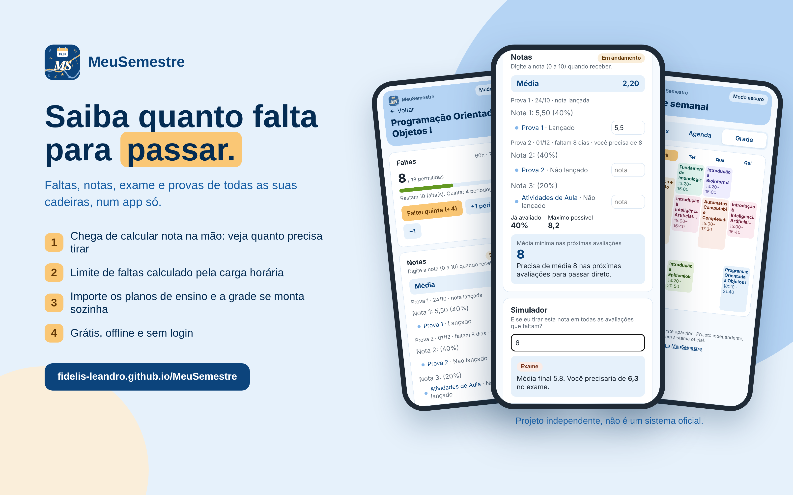

# MeuSemestre

Controle de faltas e notas para alunos da UFCSPA. Cadastre suas cadeiras e o app mostra, em tempo real, quantas faltas você ainda pode ter e quanto precisa tirar para passar, direto ou no exame.

**Acesse:** https://fidelis-leandro.github.io/MeuSemestre/

> Projeto independente feito por aluno. Não é um sistema oficial da UFCSPA.

## Funcionalidades

- **Controle de faltas por período (50 min):** informe a carga horária e o app calcula o limite de 25% (ex.: 60h = 72 períodos = 18 faltas). Um toque registra o dia inteiro de aula.
- **Notas com pesos:** cadastre as avaliações e seus pesos. Cada nota pode ser dividida em partes (ex.: prova + trabalho).
- **Quanto falta para a média 7:** a cada nota lançada, o app recalcula a média mínima necessária nas próximas avaliações.
- **Cálculo do exame:** se a média ficar entre 4 e 6,9, mostra a nota necessária no exame.
- **Hoje e grade semanal:** a tela inicial mostra a aula de agora, a próxima e as aulas do dia, com um botão "Faltei hoje" que registra as faltas de todas as aulas do dia de uma vez. A aba Grade mostra a semana em formato de tabela.
- **Agenda:** adicione a data de cada avaliação e eventos avulsos (trabalhos, seminários, datas limite). A agenda separa em "Esta semana", "Próximas semanas" e "Já passou", e a tela inicial mostra as próximas avaliações.
- **Simulador:** teste uma nota hipotética e veja se você passaria direto, iria para exame ou reprovaria.
- **Importar planos de ensino:** escolha os PDFs dos planos de ensino de todas as cadeiras de uma vez. O app cadastra cada cadeira com carga horária, dias de aula, avaliações, pesos, datas de prova e exame, e aulas EAD na agenda. O plano é um documento público da disciplina, sem dados pessoais, e é lido no próprio navegador.
- **Backup:** salve todos os dados num arquivo e restaure em outro aparelho. O app lembra de fazer backup a cada 7 dias.
- **App instalável (PWA):** adicione à tela inicial e ele abre como um app, com ícone próprio. Depois da primeira visita, funciona totalmente offline, inclusive a leitura do PDF.
- **Modo escuro:** segue o tema do celular automaticamente, ou pode ser escolhido manualmente.
- **Sem login e sem servidor:** os dados ficam salvos no próprio aparelho.

## Regras utilizadas

| Situação | Regra |
|---|---|
| Aprovação direta | Média ≥ 7 |
| Exame | Média entre 4 e 6,9 e presença ≥ 75% |
| Reprovação | Média < 4 ou faltas acima de 25% |
| Nota final com exame | 0,6 × média + 0,4 × exame ≥ 6 |
| Nota necessária no exame | 15 − 1,5 × média |

## Tecnologias

HTML, CSS e JavaScript puro, em um único arquivo. A leitura do PDF usa a biblioteca PDF.js (Mozilla), incluída no projeto. Service Worker e Web App Manifest para funcionar offline e ser instalável. Os dados ficam em `localStorage` e o site é hospedado no GitHub Pages.

## Como usar localmente

Baixe o `index.html` e abra no navegador. Não precisa instalar nada.

## Autor

**Leandro Fidelis**, estudante de Informática Biomédica na UFCSPA.
